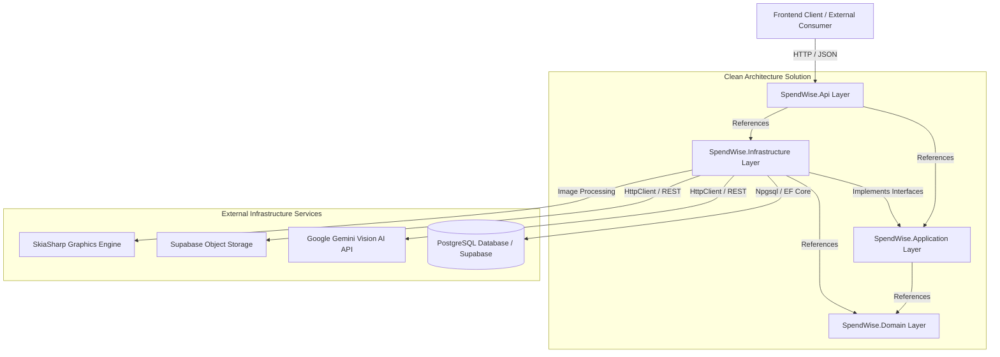
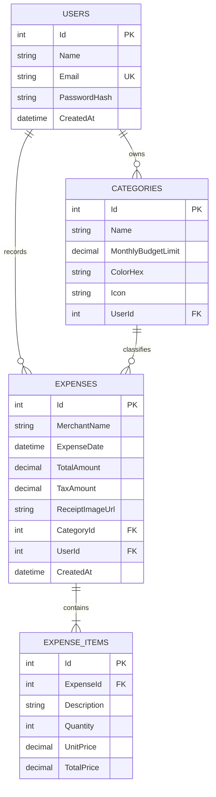
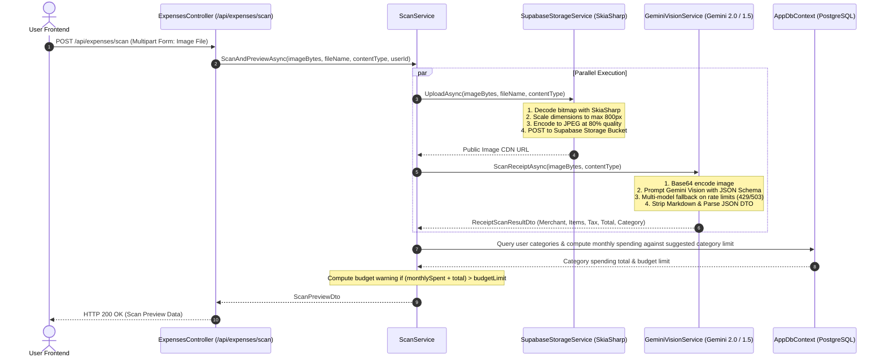

# SpendWisely - Backend Architecture & Technical Documentation

SpendWisely's backend is a RESTful API built on **ASP.NET Core (.NET 8)** implementing **Clean Architecture (Onion Architecture)** principles. It handles secure user authentication, category budget tracking, expense aggregation, multimodal AI receipt scanning via **Google Gemini Vision**, and automated image optimization with **SkiaSharp** before storing receipts in **Supabase Cloud Storage**.

---

## 1. Architectural Overview & Solution Structure

The backend solution is partitioned into four distinct layers according to Clean Architecture guidelines to enforce separation of concerns, maintainability, and testability.



### Layer Responsibilities

```text
SpendWise.sln
├── src/
│   ├── SpendWise.Domain/         # Core Enterprise Entities & Business Rules (No External Dependencies)
│   ├── SpendWise.Application/    # DTOs, Service Contracts & Interfaces (Depends on Domain)
│   ├── SpendWise.Infrastructure/ # EF Core DbContext, Migrations, External Service Clients (Depends on App & Domain)
│   └── SpendWise.Api/            # ASP.NET Core Controllers, Middleware, JWT Config (Entry Point)
```

1. **`SpendWise.Domain`**:
   - Contains core domain entities: `AppUser`, `Category`, `Expense`, `ExpenseItem`.
   - Free from external frameworks or database-specific logic.
2. **`SpendWise.Application`**:
   - Declares data transfer objects (DTOs) and service interfaces (`IAuthService`, `IExpenseService`, `ICategoryService`, `IScanService`, `IGeminiVisionService`, `IReceiptStorageService`).
3. **`SpendWise.Infrastructure`**:
   - Implements application interfaces.
   - Encapsulates database operations (`AppDbContext`, EF Core PostgreSQL migrations).
   - Integrates external APIs: Google Gemini Vision, Supabase Storage, and SkiaSharp image compression.
4. **`SpendWise.Api`**:
   - Exposes RESTful HTTP endpoints via ASP.NET Core controllers.
   - Configures JWT bearer authentication, CORS policies, Swagger/OpenAPI documentation, and dependency injection.

---

## 2. Technology Stack & Key Packages

| Technology / Library | Version | Purpose |
| :--- | :--- | :--- |
| **.NET SDK** | `8.0` (C# 12) | Core runtime and language framework |
| **ASP.NET Core Web API** | `8.0` | High-performance HTTP web server framework |
| **Entity Framework Core** | `8.0.11` | Object-Relational Mapper (ORM) for data access |
| **Npgsql.EntityFrameworkCore.PostgreSQL** | `8.0.11` | PostgreSQL database provider for EF Core |
| **BCrypt.Net-Next** | `4.0.3` | Secure salted password hashing |
| **Microsoft.AspNetCore.Authentication.JwtBearer** | `8.0.11` | JWT bearer token authentication middleware |
| **System.IdentityModel.Tokens.Jwt** | `7.1.2` | JWT generation and validation handler |
| **SkiaSharp / SkiaSharp.NativeAssets.Win32** | `4.152.1` | Cross-platform 2D graphics engine for receipt image resizing and compression |
| **Google Gemini Vision API** | REST (`v1beta`) | Multimodal generative AI model for receipt OCR data extraction |
| **Supabase Cloud Storage** | REST API | S3-compatible cloud object storage for compressed receipt images |
| **Swashbuckle.AspNetCore** | `6.6.2` | Interactive Swagger UI and OpenAPI documentation |
| **DotNetEnv** | `3.1.1` | `.env` environment variable loader for local development |

---

## 3. Database Schema & Domain Model

The database schema is managed via EF Core Code-First migrations with PostgreSQL data types.



### Relational Constraints & Cascade Rules
- **`AppUser` -> `Category`**: 1-to-Many (`OnDelete(DeleteBehavior.Cascade)`).
- **`AppUser` -> `Expense`**: 1-to-Many (`OnDelete(DeleteBehavior.Cascade)`).
- **`Category` -> `Expense`**: 1-to-Many (`OnDelete(DeleteBehavior.Restrict)`). Deleting a category is blocked if active expenses are assigned to it.
- **`Expense` -> `ExpenseItem`**: 1-to-Many (`OnDelete(DeleteBehavior.Cascade)`).
- **Default Categories Seeding**: When a new user registers via `AuthService.RegisterAsync`, five initial categories are automatically created for that user:
  1. `Dining` (Limit: $500, Icon: `restaurant`, Color: `#FF6B6B`)
  2. `Groceries` (Limit: $800, Icon: `shopping_cart`, Color: `#51CF66`)
  3. `Travel` (Limit: $1500, Icon: `flight`, Color: `#339AF0`)
  4. `Utilities` (Limit: $300, Icon: `bolt`, Color: `#F59F00`)
  5. `Electronics` (Limit: $1000, Icon: `devices`, Color: `#845EF7`)

---

## 4. AI Receipt Vision & Storage Pipeline

The receipt processing pipeline executes parallelized OCR extraction and image optimization to ensure minimal latency and storage footprint.



### Multimodal Gemini AI OCR Implementation
- **Prompt Engineering**: The service strictly requests a pure JSON response matching the required schema:
  ```json
  {
    "merchant": "string",
    "date": "YYYY-MM-DD",
    "total": 0.00,
    "tax": 0.00,
    "categorySuggestion": "Dining | Groceries | Travel | Utilities | Electronics",
    "items": [
      { "description": "string", "quantity": 1, "unitPrice": 0.00, "totalPrice": 0.00 }
    ]
  }
  ```
- **Resilience & Model Fallback**: If the primary configured model (`gemini-3.6-flash` or `gemini-1.5-flash`) encounters quota throttling (`HTTP 429`) or temporary overload (`HTTP 503`), the service executes an exponential backoff retry loop and falls back across candidate models (`gemini-3.6-flash`, `gemini-3.1-flash-lite`, `gemini-3.8-flash`).

### SkiaSharp Image Compression
- Receipt images often exceed 5MB–10MB when captured on mobile devices.
- `SupabaseStorageService` decodes the raw image stream into a `SKBitmap`, computes proportional dimensions capped at **800px**, and compresses the output to **JPEG at 80% quality**.
- This reduces receipt file sizes to typically under **100KB–150KB** (>90% bandwidth and storage reduction) while preserving full visual legibility.

---

## 5. REST API Endpoints Reference

All endpoints (except `/api/auth/register` and `/api/auth/login`) require a valid JWT passed in the HTTP header:
`Authorization: Bearer <token>`.

### Authentication Endpoints (`/api/auth`)

| Method | Route | Description | Request Body | Status Codes |
| :--- | :--- | :--- | :--- | :--- |
| `POST` | `/api/auth/register` | Register new user & seed default categories | `{ name, email, password }` | `200 OK`, `409 Conflict` |
| `POST` | `/api/auth/login` | Authenticate user & issue JWT token | `{ email, password }` | `200 OK`, `401 Unauthorized` |
| `GET` | `/api/auth/me` | Fetch authenticated user profile | - | `200 OK`, `401 Unauthorized` |
| `DELETE`| `/api/auth/account` | Permanently delete user account & all data | - | `204 NoContent`, `401 Unauthorized` |

### Category Endpoints (`/api/categories`)

| Method | Route | Description | Request Body | Status Codes |
| :--- | :--- | :--- | :--- | :--- |
| `GET` | `/api/categories` | Get all categories for authenticated user | - | `200 OK` |
| `GET` | `/api/categories/{id}` | Get specific category by ID | - | `200 OK`, `404 NotFound` |
| `POST` | `/api/categories` | Create new category with budget limit | `{ name, monthlyBudgetLimit, colorHex, icon }` | `201 Created` |
| `PUT` | `/api/categories/{id}` | Update existing category name, limit, icon, or color | `{ name, monthlyBudgetLimit, colorHex, icon }` | `200 OK`, `404 NotFound` |
| `DELETE`| `/api/categories/{id}` | Delete category (blocked if assigned to active expenses) | - | `204 NoContent`, `400 BadRequest`, `404 NotFound` |

### Expense & Analytics Endpoints (`/api/expenses`)

| Method | Route | Description | Query / Form Params | Status Codes |
| :--- | :--- | :--- | :--- | :--- |
| `GET` | `/api/expenses` | Get filtered expense list | `?fromDate=&toDate=&categoryId=` | `200 OK` |
| `GET` | `/api/expenses/{id}` | Get detailed expense by ID with line items | - | `200 OK`, `404 NotFound` |
| `POST` | `/api/expenses` | Create new expense record with line items | `CreateExpenseDto` | `201 Created` |
| `DELETE`| `/api/expenses/{id}` | Delete expense record | - | `204 NoContent`, `404 NotFound` |
| `GET` | `/api/expenses/monthly-total` | Get sum of spending for category in month | `?categoryId=&year=&month=` | `200 OK` |
| `GET` | `/api/expenses/analytics` | Get monthly metrics, category breakdown & 6-mo trend | `?year=&month=` | `200 OK` |
| `GET` | `/api/expenses/export-csv` | Download RFC 4180 CSV export of filtered transactions | `?fromDate=&toDate=&categoryId=` | `200 OK (text/csv)` |
| `POST` | `/api/expenses/scan` | Upload receipt image for AI Vision OCR extraction | Multipart Form (`file`: JPEG/PNG/WebP, <=10MB) | `200 OK`, `400 BadRequest`, `503 Service Unavailable` |

---

## 6. Security & Authentication Architecture

### JWT (JSON Web Token) Implementation
- Tokens are signed using **HMAC-SHA256** with a symmetric security key defined in server configuration.
- Token claims payload includes:
  - `sub` / `NameIdentifier`: User ID (`int`).
  - `email`: User email address.
  - `name`: User display name.
  - `jti`: Unique GUID token identifier.
- Token validity duration is configurable (`Jwt:ExpiryHours`, default 720 hours / 30 days).

### Password Hashing
- Utilizes `BCrypt.Net-Next` with automatic cryptographic salting (`BCrypt.HashPassword` / `BCrypt.Verify`). Plaintext passwords are never stored.

### CORS Policy
- Configured via `builder.Services.AddCors()` with dynamic frontend origin handling and credential support to allow cross-domain requests from local Angular dev servers (`localhost:4200`) and production hosting domains.

---

## 7. Configuration & Environment Variables

The backend accepts configuration from standard `appsettings.json`, local `.env` files (loaded by `DotNetEnv`), or production container environment variables.

| Variable Name | Description | Example / Default |
| :--- | :--- | :--- |
| `ConnectionStrings__DefaultConnection` | PostgreSQL connection string | `Host=aws-0-...supabase.com;Port=5432;Database=postgres;Username=postgres;Password=...` |
| `Gemini__ApiKey` | Google AI Studio Gemini API Key | `AIzaSy...` |
| `Gemini__BaseUrl` | Gemini REST Endpoint | `https://generativelanguage.googleapis.com` |
| `Gemini__Model` | Primary Gemini model identifier | `gemini-3.6-flash` |
| `Supabase__Url` | Supabase Project URL | `https://your-project.supabase.co` |
| `Supabase__ServiceKey` | Supabase Storage Secret/Service API Key | `eyJhbGciOi...` |
| `Jwt__Key` | Secret key for signing JWT tokens (min 32 bytes) | *Cryptographically random secret string* |
| `Jwt__Issuer` | JWT Issuer claim | `SpendWisely` |
| `Jwt__Audience` | JWT Audience claim | `SpendWiselyApp` |
| `Jwt__ExpiryHours` | Token lifetime in hours | `720` |

---

## 8. Build, Execution & Containerization

### Local Execution
```powershell
# Navigate to backend directory
cd backend

# Restore and run the Web API project
dotnet run --project src/SpendWise.Api
# -> Running on http://localhost:8000
# -> Swagger UI available at http://localhost:8000/swagger
```

### Database Migrations
```powershell
# Apply pending EF Core migrations to PostgreSQL database
dotnet ef database update --project src/SpendWise.Infrastructure --startup-project src/SpendWise.Api

# Create a new migration
dotnet ef migrations add <MigrationName> --project src/SpendWise.Infrastructure --startup-project src/SpendWise.Api
```

### Docker Deployment (`backend/Dockerfile`)
The backend uses a multi-stage Docker build optimized for production hosting on platforms like Render:

```dockerfile
FROM mcr.microsoft.com/dotnet/sdk:8.0 AS build
WORKDIR /src

COPY SpendWise.sln .
COPY src/SpendWise.Api/SpendWise.Api.csproj src/SpendWise.Api/
COPY src/SpendWise.Application/SpendWise.Application.csproj src/SpendWise.Application/
COPY src/SpendWise.Domain/SpendWise.Domain.csproj src/SpendWise.Domain/
COPY src/SpendWise.Infrastructure/SpendWise.Infrastructure.csproj src/SpendWise.Infrastructure/

RUN dotnet restore
COPY . .
RUN dotnet publish src/SpendWise.Api/SpendWise.Api.csproj -c Release -o /app/publish

FROM mcr.microsoft.com/dotnet/aspnet:8.0 AS final
WORKDIR /app
COPY --from=build /app/publish .
EXPOSE 8080
ENV ASPNETCORE_URLS=http://+:8080
ENTRYPOINT ["dotnet", "SpendWise.Api.dll"]
```
